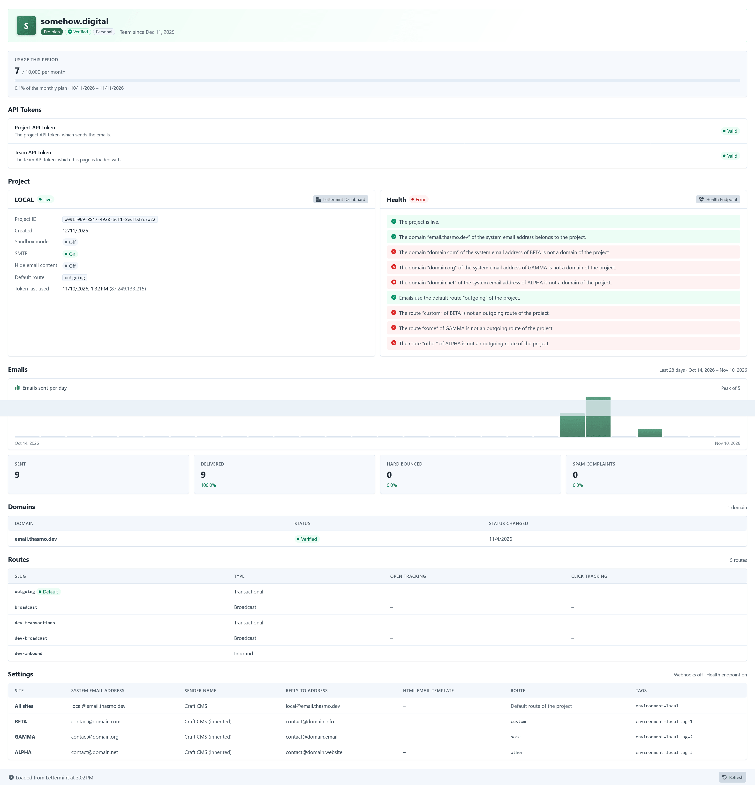

Go to **Utilities** → **Lettermint** for an overview of your team and project.

| Section  | Shows                                                                                                                                                                                                                                                          |
| -------- | -------------------------------------------------------------------------------------------------------------------------------------------------------------------------------------------------------------------------------------------------------------- |
| Team     | Name, plan and verification                                                                                                                                                                                                                                    |
| Usage    | Emails sent this billing period vs. your plan                                                                                                                                                                                                                  |
| Tokens   | Whether Lettermint accepts your API tokens                                                                                                                                                                                                                     |
| Project  | Creation date, sandbox mode, SMTP, hidden email content, default route with open and click tracking (as far as Lettermint tells), token last used, and a link to the project                                                                                   |
| Health   | Overall status and [checks](/reference/health-checks/), with a link to the [health endpoint](/features/health-endpoint/) for admins                                                                                                                            |
| Emails   | Sent, delivered, hard bounces, spam complaints, opens and clicks over 28 days, with a chart                                                                                                                                                                    |
| Domains  | Verification status of the project's domains                                                                                                                                                                                                                   |
| Routes   | Slug, type and default route of the project, with open and click tracking (as far as Lettermint tells)                                                                                                                                                         |
| Settings | One row for all sites and one per site with the System Email Address, sender name, reply-to address, HTML email template, route and tags, and the transport (with the SMTP port), and whether webhooks and the health endpoint are on. Never tokens or secrets |

## Project checks

The utility checks that:

- the project is live,
- the System Email Address domain, also of each site that overrides it, belongs to the project and is verified,
- all route slugs (adapter and sites) are outgoing routes of the project.

## Good to know

- Only the configured project is loaded, never other projects of the team.
- The **Project API Token** status works without a Team API Token.
- Sections the token can't read are hidden and show a notice.
- The page never waits for Lettermint: it loads its data in the background. Data is fresh for 5 minutes and shared with the [dashboard widget](/features/dashboard/). Older data is shown right away while it's reloaded, and before anything is loaded, the page shows its layout as a placeholder. Data is only cached when Lettermint could be reached, so an outage doesn't stick around.
- Click **Refresh** to reload the data. Saving other settings reloads it as well.
- Access requires the **Utilities** → **Lettermint** permission.
